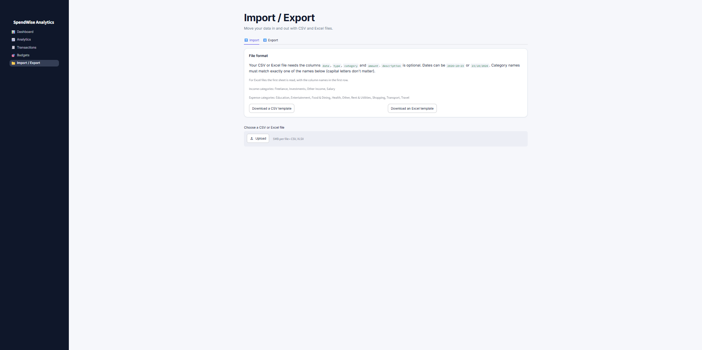

\# SpendWise Analytics


A personal finance and expense analytics dashboard. Track income and expenses, set monthly budgets, import and export CSV files, and get automatic insights from your own data.


Built with Python, Streamlit, Pandas, SQLite and Plotly.


\*\*Live demo:\*\* \_coming soon\_


!\[Dashboard](docs/screenshots/dashboard.png)


\## Features


\- \*\*Dashboard:\*\* income, expenses, balance, savings rate and budget remaining, each compared with the previous month. Includes a category donut chart, income vs expenses chart, a spending trend against last month, and automatic insights.

\- \*\*Transactions:\*\* add, edit and delete income and expenses with validation. Search, filter by type, category and date range, and sort by any column.

\- \*\*Budgets:\*\* monthly budget per expense category with progress bars and a status (on track, near limit, over budget). Copy last month's budgets in one click.

\- \*\*Analytics:\*\* savings trend and savings rate, spending by category over time, top categories, and a category-by-category comparison with the previous month.

\- \*\*Insights:\*\* plain-language findings generated from your data, such as spending changes, the category that moved most, budgets that are close to their limit, and unusually large expenses.

\- \*\*CSV and Excel import and export:** accepts `.csv` and `.xlsx` files (first sheet), validates every row, previews before importing, reports problem rows with the reason, skips duplicates, and stores descriptions safely so spreadsheet programs can't run them as formulas. Exports to CSV or a formatted Excel file.

\- \*\*Persistent storage:\*\* all data is stored in a SQLite database.


\## Screenshots


| Transactions | Budgets |

| --- | --- |

| !\[Transactions](docs/screenshots/transactions.png) | !\[Budgets](docs/screenshots/budgets.png) |


!\[Analytics](docs/screenshots/analytics.png)




\## How the calculations work


\- Income and expenses live in one table, separated by a `type` column. The database rejects any other value, and a transaction's category must match its type.

\- A budget's "spent" amount counts \*\*expenses only\*\*, in that budget's category and month. Income is never counted as spending.

\- Every page gets its numbers from the same service functions, so the Dashboard, Budgets and Analytics pages always agree.

\- Insights use simple, explainable rules. For example, an expense is flagged as unusual only if it is more than 3 times the median of your other expenses in that category, and only when there are at least 5 other expenses to compare against.


\## Run it locally


You need Python 3.10 or newer.


Windows:


```

git clone https://github.com/YOUR-USERNAME/spendwise-analytics.git

cd spendwise-analytics

python -m venv venv

venv\\Scripts\\activate

pip install -r requirements.txt

streamlit run app.py

```


macOS or Linux:


```

git clone https://github.com/YOUR-USERNAME/spendwise-analytics.git

cd spendwise-analytics

python3 -m venv venv

source venv/bin/activate

pip install -r requirements.txt

streamlit run app.py

```


The app opens at http://localhost:8501. On first run it creates `data/spendwise.db`. The Dashboard offers a \*\*Load sample data\*\* button to try the app with example data.


To use a different database file, set the `SPENDWISE\_DB` environment variable to its path before starting the app.


## CSV and Excel format

Required columns: `date`, `type`, `category`, `amount`. Optional: `description`. Excel files use the first sheet, with the column names in the first row. Both formats can be downloaded as a template from the Import tab.

```
date,type,category,amount,description
2026-10-01,income,Salary,50000,October salary
2026-10-02,expense,Food & Dining,250.00,Lunch
```

Dates can be `YYYY-MM-DD` or `DD/MM/YYYY` (real Excel dates also work). Type is `income` or `expense`. Category names must match an existing category. Uploads are limited to 5 MB.


\## Tests


The calculation logic has automated checks that run against a temporary database, so your real data is never touched:


```

python tests/test\_calculations.py

python tests/test\_analytics.py

python tests/test\_analytics\_page.py

python tests/test\_insights.py

python tests/test\_trend.py

python tests/test\_csv.py

python tests/test_excel.py

python tests/test\_sample\_data.py

```


Each script prints `PASS` or `FAIL` for every check and ends with a summary.


\## Project structure


```

app.py                  Entry point and navigation

spendwise/

&#x20; database.py           SQLite connection and schema

&#x20; ui.py                 Shared styles and UI components

&#x20; charts.py             Plotly charts

&#x20; services/

&#x20;   transactions.py     Add, edit, delete, list and validate transactions

&#x20;   budgets.py          Monthly budgets and budget status

&#x20;   analytics.py        Summaries, trends and comparisons

&#x20;   insights.py         Automatic insights and unusual-expense detection

&#x20;   CSV and Excel import and export

&#x20;   sample\_data.py      Example data generator

views/                  One file per page

tests/                  Automated checks

.streamlit/config.toml  Theme

```


\## Limitations


\- SpendWise is a single-user app with no login. If it is hosted publicly, every visitor shares the same database, and free hosting platforms may reset local files when an app restarts. Use it locally for your own finances, or treat a hosted copy as a demo.

\- Currency is shown in rupees (₹).


\## Roadmap


\- Hosted Postgres database and user accounts for a private multi-device deployment

\- Recurring transaction detection

\- Configurable currency

